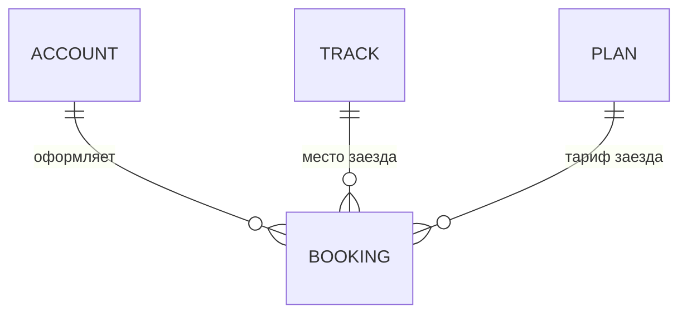

# KART RUSH — бронирование заездов на картинге

**Проект из портфолио Питернева И. · группа ИСИП 5-25**

В KART RUSH я показал один заезд с двух сторон: пилот выбирает трассу и время, а администратор подтверждает или отменяет заявку. Если открыть оба кабинета в разных вкладках, пилот увидит решение администратора без обновления страницы.

Это учебное приложение на **React и TypeScript**. Брони сохраняются только в браузере: сайт не принимает оплату и не резервирует время на реальном картодроме.


## Быстрый старт

В каталоге [`dist/`](./dist/) уже лежит готовый сайт. Чтобы посмотреть его без установки Node.js и сборки проекта, запустите HTTP-сервер из корня репозитория:

```sh
git clone https://github.com/morteris/PortfolioKarting.git
cd PortfolioKarting
python3 -m http.server 8080 --bind 127.0.0.1 --directory dist
```

Откройте **[localhost:8080](http://localhost:8080)**. Нужен Python 3; в Windows вместо `python3` можно использовать `py`. Если проект скачан ZIP-архивом, достаточно распаковать его и выполнить последнюю команду в папке, где находится `dist`.

## Попробовать обе роли

| Демоаккаунт | Логин | Пароль |
| --- | --- | --- |
| Пилот | `pilot@kart.test` | `Pilot2026` |
| Администратор | `admin@kart.test` | `Admin2026` |

1. На главной нажмите **«Войти» → «Пилот» → «Войти в кабинет»**. Кнопка роли подставляет логин и пароль; обе пары также указаны внизу каждой страницы.
2. В кабинете нажмите **«Новая бронь»**. Например, выберите «Неон Арену», тариф «Гонка», двух пилотов и свободное время. За 30 минут получится **7 800 ₽**: по 3 900 ₽ за пилота. После оформления заявка появится в разделе **«Мои брони»** со статусом «На рассмотрении».
3. Оставьте кабинет пилота открытым. Во второй вкладке того же браузера откройте **тот же адрес сайта**, выберите внизу **«Войти как админ»** и подтвердите вход. В разделе **«Управление заявками»** подтвердите бронь. Вернитесь к пилоту: у заявки тот же номер, но статус уже **«Подтверждена»**.

## Как выбирается свободное время

В каталоге три трассы: **«Неон Арена», «Асфальт Ринг» и «Дрифт Паддок»**. Занятость считается отдельно для каждой трассы и по всей длительности заезда, а не только по времени старта. Например, если «Неон Арена» занята с 13:00 до 13:30, оформить на ней двухчасовой «Корпоратив» с 11:30 нельзя: последние полчаса совпадут. На доступность двух других трасс эта бронь не повлияет.

- Выбрать можно будущий заезд не более чем на 90 дней вперёд. Время московское (UTC+3); заезд должен закончиться не позднее 23:00.
- Для «Спринта», «Гонки» и «Гран-при» стоимость зависит от числа пилотов, для «Корпоратива» — фиксирована за мероприятие.
- Заявки на рассмотрении и подтверждённые занимают время. После отмены интервал освобождается, а запись остаётся в истории.

## Как устроен проект

Бронирование связывает три объекта: **кто едет, где проходит заезд и по какому тарифу**. Это логическая модель данных, а не схема развёрнутой SQL-базы:



- [Каталог](./src/data.ts) содержит трассы, длительность заездов и тарифы. [Правила бронирования](./src/domain/booking.ts) проверяют пересечения, считают цену и определяют, кто может изменить статус.
- [Модуль хранения](./src/demo/store.ts) записывает брони в `localStorage`, а идентификатор роли — в `sessionStorage` текущей вкладки. Поэтому история сохраняется после выхода, но не переносится на другое устройство. Демоаккаунты публичны и не заменяют серверную авторизацию.
- [Интерфейс](./src/pages/) построен на React 19, React Router и Tailwind CSS. Есть русский и английский языки, мобильная навигация и управление с клавиатуры. При наведении на карточку красная метка проходит круг по контуру трассы; [анимации](./src/styles/motion.css) отключаются при `prefers-reduced-motion`.

## Разработка и проверка

Для работы с исходниками рекомендуются **Node.js 22.12+** и npm. Если проект обновлялся поверх старой версии, сначала проверьте примечание ниже.

```sh
npm ci
npm run dev
```

Vite выведет адрес сайта, по умолчанию **[localhost:3000](http://localhost:3000)**. Для сборки выполните `npm run build`, для просмотра результата — `npm run preview`. Каталог `dist/` можно разместить на статическом хостинге.

В [`tests/`](./tests/) — 15 автоматических проверок: семь проверяют правила бронирования, пять — путь пользователя в браузере, ещё три — анимации и режим уменьшенного движения.

```sh
npm run lint
npx playwright install chromium --with-deps
npm test
```

<details>
<summary>Если при сборке появляется ошибка «Module './i18n' has no exported member 'Message'»</summary>

В версии 1.0.1 переводы находятся в [`src/i18n/index.ts`](./src/i18n/index.ts). Если рядом остался старый файл `src/i18n.tsx`, TypeScript выбирает его вместо нового модуля. В этой версии также больше не используется `src/components/FlipCard.tsx`, который обращается к прежним ключам переводов.

После сохранения собственных правок уберите эти два устаревших файла из `src/`, **оставив папку `src/i18n/`**, и повторите `npm run build`. Для просмотра уже собранного `dist/` этот шаг не нужен.

</details>
